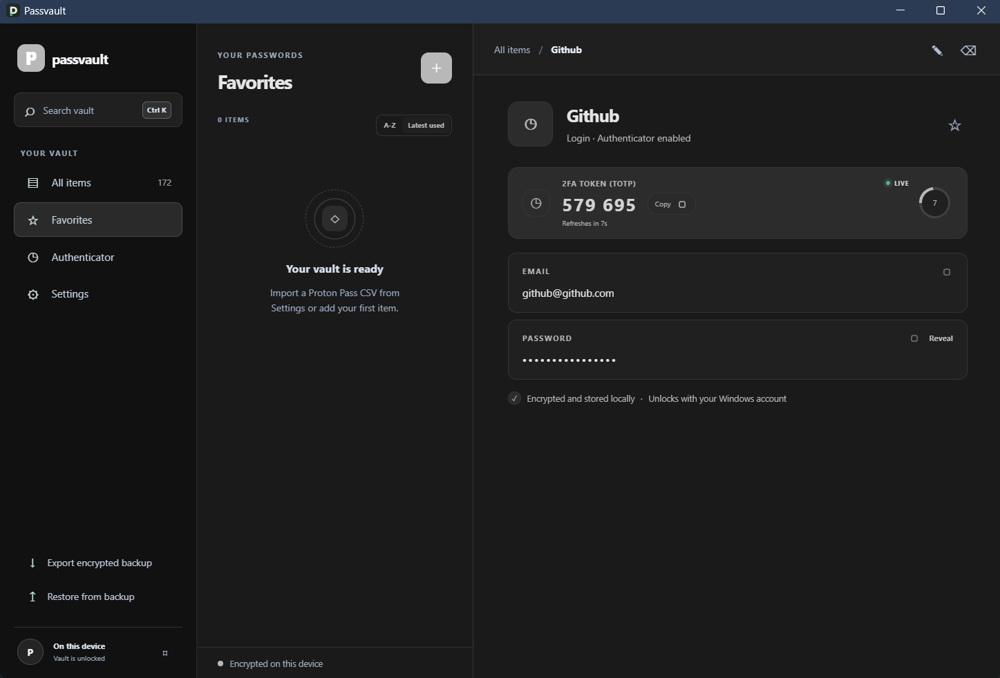
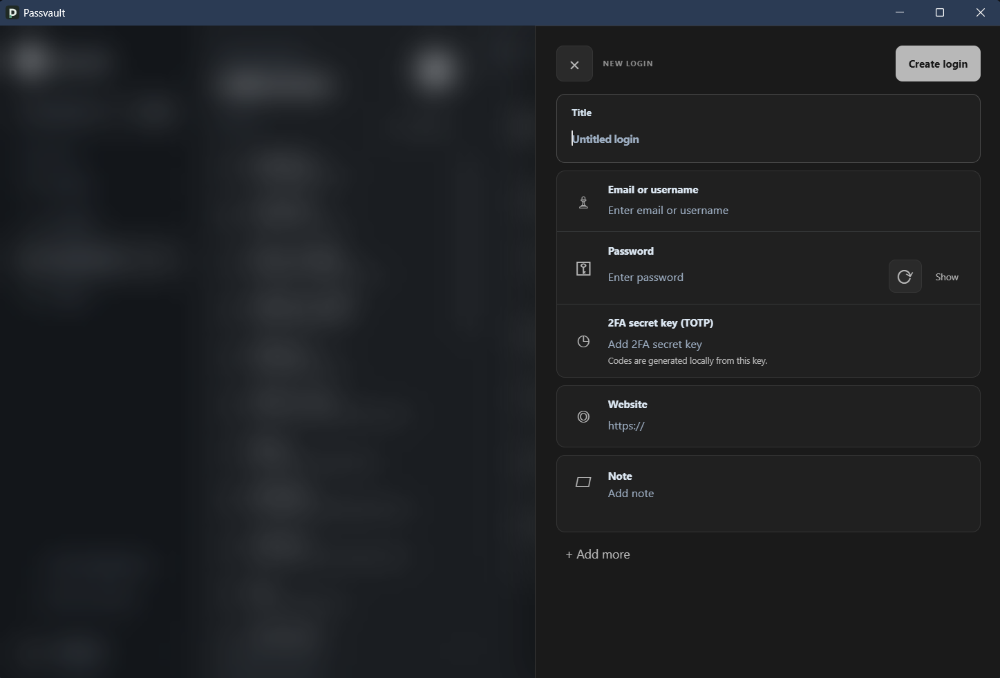
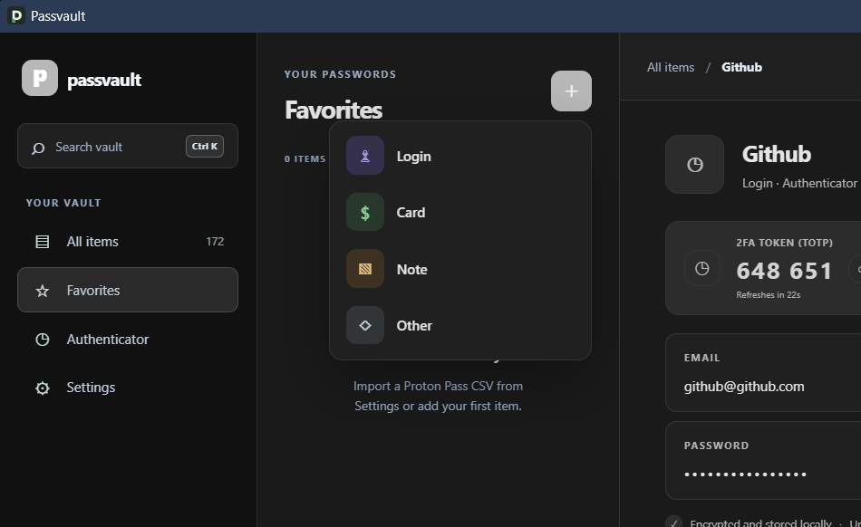

# PassVault

Passvault is a Windows-first, local-only password manager built with Tauri 2, Rust, and Svelte. The vault is encrypted on this device; there is no account, server, telemetry, or sync in v1.

## Screenshots

<p align="center">
  
</p>

<p align="center"><sub>The workspace: navigation, searchable item list, and item details with live TOTP codes.</sub></p>

| New login | Item type picker |
|:---:|:---:|
|  |  |
| Compose logins with email, password, TOTP, website, and notes. | Pick Login, Card, Note, or Other when adding an item. |

## Features

- Create and unlock a vault protected by a master password.
- Store logins, secure notes, TOTP authenticator keys, and credit cards with dedicated number, expiration, cardholder, security code, and PIN fields.
- Use a Proton-inspired glass workspace in a rounded, frameless Windows window, with optional SVG refraction accents and a CSS blur fallback.
- Switch between persistent light and dark themes in Settings.
- Import Proton Pass CSV exports with a preview, unsupported-column warnings, and possible-duplicate detection. Login email, username, TOTP, notes, item type, source vault, and original timestamps are retained; card note payloads are mapped into card fields, while alias, identity, and custom-item note payloads are preserved.
- Generate passwords with guaranteed selected character classes and no adjacent repeated characters, search and favorite items, and copy secrets with a 30-second clipboard clear attempt.
- Scan a TOTP setup QR code from the screen: the vault window hides, each monitor shows a frozen frame, and you draw a box around the code and confirm to fill the 2FA key field. Default setups are stored as a bare Base32 secret; custom algorithm, digit, or period settings are stored as an `otpauth://` URI.
- Automatically lock after 15 minutes of inactivity.
- Export and restore an encrypted `.passvault` backup.

## Windows Development Setup

Install:

- Rust stable with the MSVC target (`rustup default stable-x86_64-pc-windows-msvc`).
- Visual Studio 2022 Build Tools with the Desktop development with C++ workload and Windows SDK.
- Node.js LTS and npm.
- Microsoft Edge WebView2 Runtime.

Then run from this folder:

```powershell
npm install
npm run tauri dev
```

Build Windows installers with:

```powershell
npm run tauri build
```

The NSIS and MSI installers are written under `src-tauri/target/release/bundle/`.

## Storage and Security Notes

- Vault data is kept under the Windows **Local** application data directory and encrypted with Argon2id-derived keys and XChaCha20-Poly1305 authenticated encryption.
- Losing the master password means losing access to the vault. Keep encrypted backups somewhere safe and separate from this device.
- Restoring a backup replaces the current vault and requires the backup's master password.
- TOTP codes are generated locally with SHA-1/6-digit/30-second defaults, while explicit `otpauth://` parameters are honored. Secret normalization accepts Base32 formatting and raw-secret fallback. Treat imported CSV files, screenshots, clipboard contents, and exported backups as sensitive.
- Screen scanning reads monitor pixels into memory only: no screenshot is written to disk and nothing is sent over the network. The overlay shows the full frozen frame (dimmed outside your selection) until it closes, so scan only a region showing the QR code. Windows protected by DRM or hardware composition can capture as black, which prevents a QR code in them from being read.
- This is an early v1 and has not received an independent security audit. Do not make it the only copy of important credentials until you have verified import, restore, and recovery behavior yourself.
